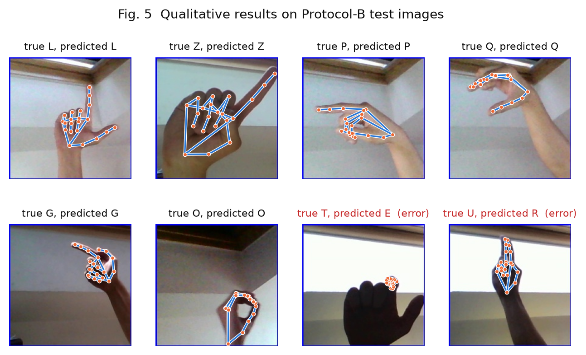
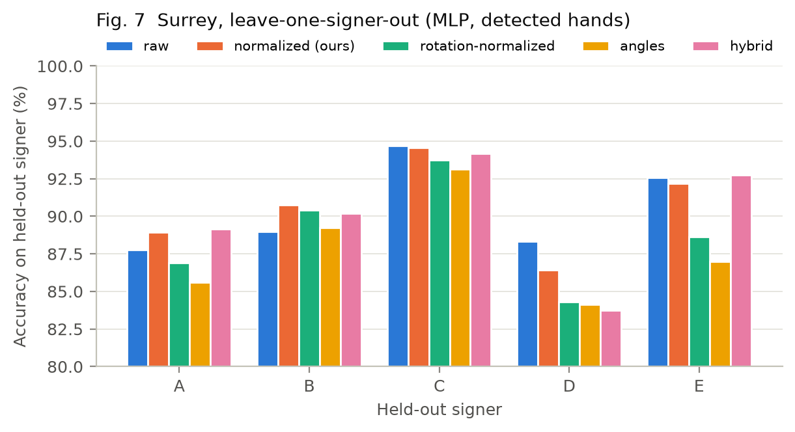
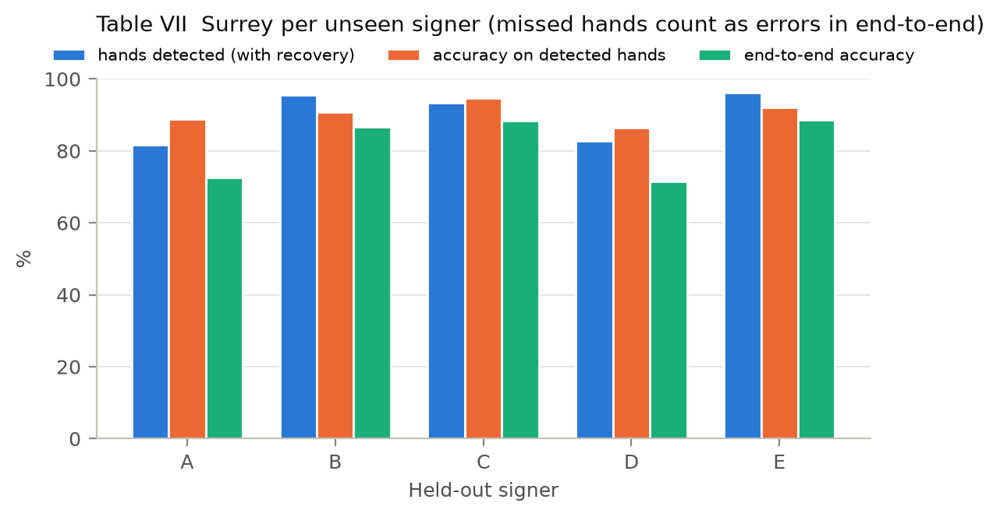
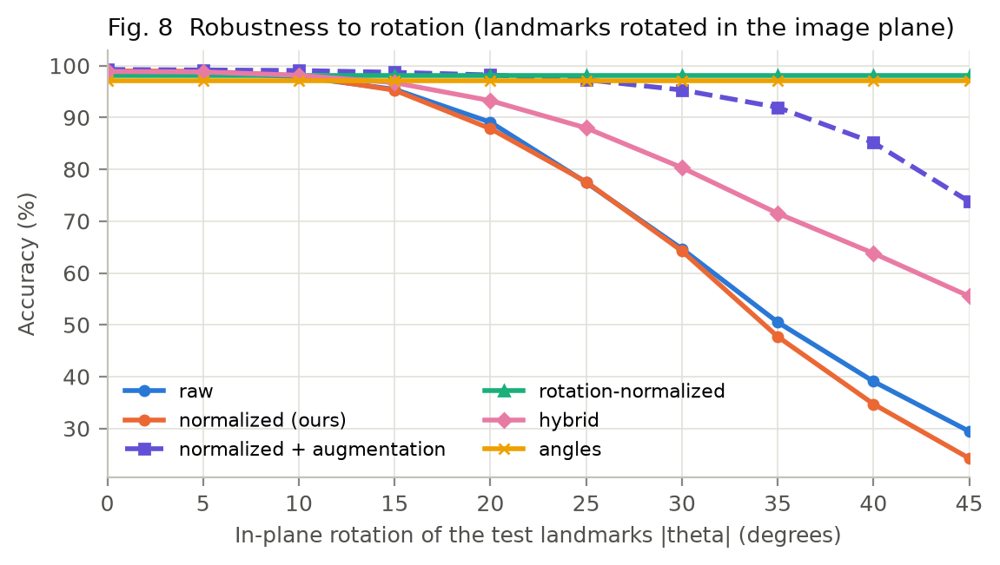
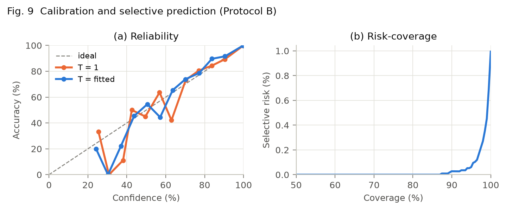

# ASL fingerspelling from hand landmarks

Code and data for our paper:

R. Ponnala and Md. Kaleem, "Hand-Landmark Recognition of ASL Fingerspelling: How Well Does It Generalize,
and When Should It Abstain?", IEEE Access, 2026 (DOI will be added after publication).

We take the 21 hand landmarks from MediaPipe Hands, move the origin to the wrist and divide by the palm size,
and classify the resulting 63 numbers into the letters A-Z with a small MLP (18,138 parameters). If the top
softmax probability is below 0.8 the recognizer abstains. Most of the paper is about how far this
generalizes (near-duplicate images, new signers, a new dataset, left hands, rotation) and how well the
abstain rule works.



## What is here

- `experiments/` all the code. `common.py` has the features, the MLP and the paths; the scripts `s1` to `s11`
  run the experiments in order. `collect_results.py` puts every number into one csv file and
  `make_figures.py` draws the plots. `demo_predict.py` runs the trained model on your own images.
- `results/` the trained models (`mlp_fp32.onnx`, `mlp_int8.onnx`, `cnn_fp32.onnx`), the json files written
  by each script and `all_results.csv` with all values.
- `data/landmarks/` the landmarks we extracted for all 153,644 images, so you can rerun most experiments
  without downloading the images. Column description in `data/README.md`.
- `outputs/` the data behind each figure (`figure_data/`), the figures as png (`figures/`) and the eight
  example images of Fig. 5.

## Setup

We used Python 3.12 on Windows 11.

```
python -m venv .venv
.venv\Scripts\activate           (Linux: source .venv/bin/activate)
pip install -r requirements.txt --extra-index-url https://download.pytorch.org/whl/cu126
```

`requirements.txt` pins the CUDA 12.6 build of PyTorch. On a machine without an NVIDIA GPU, remove `+cu126`
from the torch and torchvision lines and use https://download.pytorch.org/whl/cpu instead. Only the two CNN
baselines (`s5_cnn.py`, `s7_cnn_crop.py`) need a GPU.

## Trying the model

```
python experiments/demo_predict.py my_photo.jpg some_folder/
python experiments/demo_predict.py --webcam
```

It prints the letter, `abstain` or `no hand` for each image. All training images show the right hand of one
person, so add `--flip` for a left hand. Do not expect the in-distribution 99%: on signers it has not seen it
gets about 90% (81.6% if missed detections are counted), and on the ASL Alphabet Test images about 89%.

If you want to call the ONNX model yourself: input `x` has shape (n, 63) and is computed with
`common.feat_norm` from the landmarks scaled as in `s1_extract.py` (x*w/S, y*h/S, z*w/S, S = max(w, h)).
Output `logits` has 26 columns, A to Z.

## Data

| dataset | used for | link |
|---|---|---|
| ASL Alphabet | training, in-distribution tests | https://www.kaggle.com/datasets/grassknoted/asl-alphabet |
| ASL Alphabet Test | cross-dataset test | https://www.kaggle.com/datasets/danrasband/asl-alphabet-test |
| Surrey ASL Fingerspelling Dataset A (5 signers) | unseen signers | https://www.kaggle.com/datasets/mrgeislinger/asl-rgb-depth-fingerspelling-spelling-it-out |

`python experiments/download_data.py` gets all three with kagglehub (you may need a Kaggle API token).
We do not redistribute the images; please check the terms of each dataset.

## Running the experiments

```
python experiments/download_data.py
python experiments/s1_extract.py          # landmarks, ~25 min
python experiments/s2_main.py             # ~12 min
python experiments/s3_generalization.py
python experiments/s4_calibration.py
python experiments/s5_cnn.py              # GPU
python experiments/s6_handedness.py
python experiments/s7_cnn_crop.py         # GPU
python experiments/s8_seeds.py
python experiments/s9_extra.py ab
python experiments/s9_extra.py c        # with PYTHONHASHSEED=0, see below
python experiments/s10_tuned.py
python experiments/s11_signers_threshold.py ad
python experiments/collect_results.py
python experiments/make_figures.py
```

You can skip the first two steps: without `data/cache/` the scripts read the landmark files in
`data/landmarks/`. The images are still needed by s1, s5, s7, part a of s9 and the timing and example-image
parts of s2. Setting `PILOT=1` runs s2-s4 and s6 on the small test set in about two minutes, which is handy
to check the setup (the numbers are then meaningless).

Part c of s9 (the fingerspelling simulation, Table XIV) has to be run on its own as shown, and with the
environment variable `PYTHONHASHSEED=0`: the spelling corrector breaks ties between equally likely words in
Python's set order, so without a fixed hash seed one value (doubled-letter CER after correction) moves by
about 0.3 points between runs.

Our runs were on an Intel Core i9-12900 with 64 GB RAM and an RTX 3060. Seed 42 everywhere, seeds 42-46 for
the repeated cross-dataset and handedness runs.

Which script gives which part of the paper:

| paper | script |
|---|---|
| Table II | s2, s3 |
| Tables III and XIII | s2, s5, s7 (tuned baselines in the text: s9 b, s10) |
| Tables IV, V, X | s2 |
| Table VI | s3, s9 a |
| Table VII | s11 a |
| Table VIII | s2, s3, s5, s7, s8 |
| Table IX | s6, s8 |
| Table XI | s4, s9 c, s11 d |
| Table XII | s1, s2, s3 |
| Table XIV | s9 c |
| Figs. 3, 4, 5, 8, 10 | s2 |
| Figs. 6, 7 | s3 |
| Fig. 9 | s4 |

The keys in `results/all_results.csv` are the macro names we used in the LaTeX source of the paper.

## Main numbers

| | |
|---|---|
| 5-fold CV on ASL Alphabet (random split) | 99.23 ± 0.18% |
| test images with an identical hash in the training split | 49.5% |
| unseen vs. seen Surrey signers (detected hands) | 90.57% vs. 98.02% |
| unseen Surrey signers, missed hands counted as errors | 81.6% |
| ASL Alphabet Test: MLP / CNN on hand crops / CNN on full frames | 89.16% / 75.72% / 30.94% |
| Surrey cross-dataset, without / with mirror augmentation | 18.48% / 52.23% |
| del and space rejected at 0.8 / transitions between letters rejected | 63.53% / 39.04% |
| simulated words correct, raw / after spelling correction | 35.7% / 62.0% |
| speed on one CPU thread | 49 images/s, 104 video frames/s |

Note that the rotation test (Fig. 8) rotates the landmarks, not the images, and that mirror and rotation
augmentation were only tested separately.

 
 

## Citing

```
@article{ponnala2026asl,
  author  = {Ponnala, Ramesh and Kaleem, Md.},
  title   = {Hand-Landmark Recognition of {ASL} Fingerspelling: How Well Does It Generalize, and When Should It Abstain?},
  journal = {IEEE Access},
  year    = {2026}
}
```

Please cite the three datasets and MediaPipe as well.

## License

MIT for the code (see `LICENSE`). The models and landmark files are derived from the datasets above, so
their terms apply to those files too.

Questions: Ramesh Ponnala, IcfaiTech, ICFAI Foundation for Higher Education, Hyderabad
(ramesh.ponnala@ifheindia.org).
